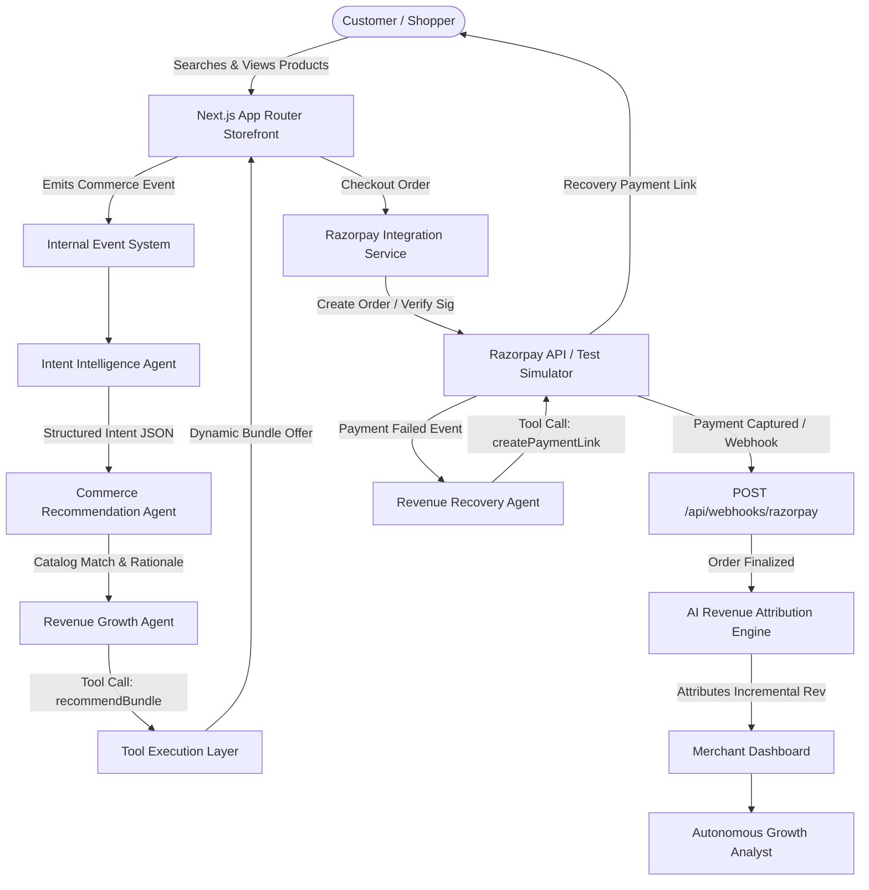

# ANTARA — Autonomous AI Growth & Agentic Commerce Platform

> **"The agent between intention and action."**  
> *Track 1: AI Growth & Agentic Commerce — Razorpay AI Builder Internship 2026*

---

## 📌 Problem

Traditional online storefronts rely on static recommendation widgets, generic discount popups, and isolated chatbots that do not actively participate in transaction conversion. When a customer drops off during checkout or experiences a bank payment gateway failure, revenue is lost permanently.

## 💡 Solution

**ANTARA** is an autonomous AI agentic commerce platform that continuously monitors customer intent, executes intelligent tool actions (dynamic bundles, cross-sells, payment recovery links), and calculates exact incremental AI revenue attribution for online merchants.

---

## 🤖 5 Specialized AI Agents Architecture

Rather than relying on a single monolithic prompt, ANTARA implements a decoupled multi-agent architecture where each agent consumes commerce events and invokes specialized tools:

1. **Intent Intelligence Agent** (`IntentAgent`)
   - **Purpose**: Decodes natural language search queries, browsing behavior, and viewed products into structured JSON intent (`intent`, `confidence`, `budget`, `preferences`, `urgency`).
   - **Tools**: `searchProducts()`, `getProductDetails()`, `getCustomerHistory()`.

2. **Commerce Recommendation Agent** (`RecommendationAgent`)
   - **Purpose**: Selects optimal primary products and complementary accessories with human-readable rationales based on catalog relevance and inventory popularity.
   - **Tools**: `searchProducts()`, `recommendBundle()`.

3. **Revenue Growth Agent** (`GrowthAgent`)
   - **Purpose**: Evaluates purchase probability vs upsell likelihood to offer timely dynamic bundles (+15% AOV) and personalized cross-sells.
   - **Tools**: `calculateCartValue()`, `calculateDiscount()`, `calculateConversionProbability()`, `recommendBundle()`.

4. **Revenue Recovery Agent** (`RecoveryAgent`)
   - **Purpose**: Detects checkout payment failures and cart abandonments, deploying instant Razorpay Payment Links with personalized 15-minute priority dispatch perks.
   - **Tools**: `createPaymentLink()`, `triggerRecoveryAction()`, `logAgentAction()`.

5. **Autonomous Growth Analyst** (`AnalystAgent`)
   - **Purpose**: Continuously audits merchant conversion metrics, attributes incremental AI revenue, and generates automated growth campaigns based on stored database metrics.
   - **Tools**: `calculateExpectedRevenue()`, `logAgentAction()`.

---

## 🏗 System Architecture Diagram (Mermaid)



---

## 💳 Razorpay Integration & Recovery Flow

ANTARA integrates Razorpay for standard checkout and automated payment recovery:

1. **Standard Checkout**:
   - Frontend calls `POST /api/payments/create-order`
   - Server initializes Razorpay Order (`RazorpayService.createOrder()`)
   - Frontend completes payment -> backend verifies signature via HMAC SHA256 (`POST /api/payments/verify`)

2. **Payment Link Recovery**:
   - When a payment failure occurs (`PAYMENT_FAILED` event), `RecoveryAgent` triggers `createPaymentLink()`
   - Generates an instant Razorpay Payment Link (`https://rzp.io/l/antara_...`)
   - Webhook listener `POST /api/webhooks/razorpay` captures `payment_link.paid` and updates Recovered Revenue metrics on the Merchant Dashboard.

---

## ⚙️ Environment Variables

Copy `.env.example` to `.env.local`:

```env
# Operating Mode (Set demo to run zero-config out of the box)
DEMO_MODE=true
AI_MODE=demo

# Optional: Live LLM Keys (Gemini / OpenAI)
GEMINI_API_KEY=
OPENAI_API_KEY=

# Optional: Razorpay Test Mode Credentials
RAZORPAY_KEY_ID=rzp_test_antara_demo_key
RAZORPAY_KEY_SECRET=antara_secret_demo_12345
RAZORPAY_WEBHOOK_SECRET=antara_webhook_secret_98765

NEXT_PUBLIC_APP_URL=http://localhost:3000
```

---

## 🚀 How to Run Locally

```bash
# 1. Install Dependencies
npm install

# 2. Run Development Server
npm run dev

# 3. Open Browser
# Storefront: http://localhost:3000/shop
# Merchant Dashboard: http://localhost:3000/dashboard
# Guided Demo Control Panel: http://localhost:3000/demo
```

---

## 🎯 Guided Demo Scenarios

Open `/demo` to run investor & judge demonstrations:
- **Run AI Growth Demo**: Automated 7-step walkthrough demonstrating intent decoding → bundle selection → Razorpay order → revenue attribution.
- **Simulate Failed Payment**: 5-step walkthrough simulating bank payment failure → Recovery Agent trigger → Razorpay Payment Link creation → payment recovery completion.

---

## 🛡 Security & Best Practices

- Secret keys (`RAZORPAY_KEY_SECRET`, `GEMINI_API_KEY`) are kept exclusively server-side in API routes and never exposed to client bundles.
- Webhook payloads are verified using HMAC SHA256 signature verification.
- Zero-config demo fallback ensures the application runs immediately without requiring paid API credentials.
